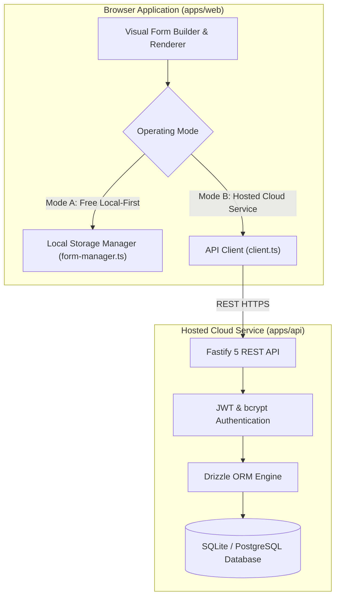

# OpenForm Steps 2.0 — Architecture Documentation

## Overview

OpenForm Steps is an accessible, high-performance open-source form-building platform and React developer library. It provides a visual no-code form builder, a pure TypeScript schema and validation engine, an accessible React renderer, and an optional hosted backend service for cloud storage, public URL sharing, and live submission processing.

---

## 1. Operating Modes Architecture

OpenForm Steps provides two operating modes:



### Mode A — Free Local-First Mode
- **Zero Account Dependency**: Works immediately in the browser without registration.
- **Client-Side Persistence**: Drafts, multi-form workspaces, and test responses are persisted in browser `localStorage`.
- **JSON Import / Export**: Standardized schema import and export for local backup and sharing.
- **Privacy by Default**: Zero remote telemetry or silent uploading of form inputs.

### Mode B — Hosted Form Service
- **Authentication**: Secure registration and session management via JWT.
- **Multi-Tenant Isolation**: Strict ownership-based authorization ensures User A can never inspect or modify User B's forms or responses.
- **Form Lifecycle States**: `draft` $\rightarrow$ `published` $\rightarrow$ `closed` $\rightarrow$ `archived`.
- **Public Shareable Links**: Direct URLs (`/?form=<formId>`) allowing anonymous visitors to view and submit published forms without creating accounts.
- **Response Limits & Expiry**: Automatically enforces `maxSubmissions` response quotas and `expiresAt` calendar expiration dates.
- **Embeddable Widgets**: Generates responsive HTML `<iframe>` codes and native React `<FormRenderer />` snippets.

---

## 2. Monorepo Layout

OpenForm Steps is organized as a pnpm workspace:

```text
openform-steps/
├── packages/
│   ├── core/       # @openform-steps/core: Schemas, AST conditions, Zod validation, state machine
│   ├── react/      # @openform-steps/react: Accessible FormRenderer, ConfirmationDialog, UI fields
│   └── builder/    # @openform-steps/builder: Embeddable React FormBuilder, palettes, modals
├── apps/
│   ├── web/        # @openform-steps/web: Production showcase app, templates, docs, cloud dashboard
│   └── api/        # @openform-steps/api: Fastify REST backend, Drizzle ORM, SQLite/PostgreSQL
├── tests/          # Cross-package Vitest unit, integration, and accessibility tests
└── docs/           # Architecture, API references, UI audits, and scalability blueprints
```

---

## 3. Core Engine (`@openform-steps/core`)

The core package has zero browser or DOM dependencies, allowing execution in Node.js, Cloudflare Workers, Edge runtimes, and browsers.

### Safe AST Condition Evaluation
Unlike systems that use unsafe `eval()` or `Function()` constructors, OpenForm Steps implements a pure Abstract Syntax Tree (AST) condition evaluator:

```typescript
export interface FieldConditionRule {
  fieldId: string;
  operator: ConditionOperator;
  value?: any;
}

export type ConditionOperator =
  | 'equals'
  | 'not_equals'
  | 'contains'
  | 'not_contains'
  | 'greater_than'
  | 'less_than'
  | 'is_empty'
  | 'is_not_empty'
  | 'in'
  | 'not_in';
```

Supported evaluation features:
- Array contains (for multi-select checkboxes)
- Numeric and ISO Date comparison
- Compound logic (`and` / `or`)
- Safe type coercion without script execution

---

## 4. Multi-Step State Machine

Form progression is evaluated dynamically at runtime:
1. When a user requests the next step, `validateStep()` runs against all visible fields in the current step.
2. If invalid, the accessible `ErrorSummary` alert receives focus with direct links to the invalid fields.
3. If valid, `getNextStepIndex()` inspects succeeding steps:
   - Evaluates step skip conditions.
   - Bypasses any steps whose conditions resolve to `skip`.
   - Returns the index of the next active step or `null` if on the final step.

---

## 5. Accessible UI Components (`@openform-steps/react`)

Designed to satisfy **WCAG 2.2 AA design targets**:
- **Semantic HTML**: `<form>`, `<fieldset>`, `<legend>`, `<label>`.
- **Progress Indicators**: Live progress bars with `role="progressbar"`, `aria-valuenow`, and descriptive labels.
- **Focus Management**: Focus moves to the step header on step change, and to the error summary on failed validation.
- **Accessible Dialogs**: Replaces native browser popups with `ConfirmationDialog` supporting keyboard focus trapping, `Escape` key cancellation, and `role="alertdialog"`.
- **Touch Targets**: Minimum $44 \times 44\text{ px}$ clickable surfaces.
- **Keyboard Navigation**: Complete keyboard operability (Tab, Shift+Tab, Enter, Space, Arrow keys).

---

## 6. Backend API Service (`@openform-steps/api`)

Built with **Fastify 5**, **Drizzle ORM**, and **TypeScript**:

- **Database Models**:
  - `users`: User identity, hashed passwords, roles.
  - `forms`: Multi-step form definitions, owner ID, status, max submissions, expiration dates.
  - `submissions`: Encrypted/sanitized field responses, anonymized IP hash, timestamp.
  - `audit_events`: System audit log for compliance and activity tracking.
- **Security & Privacy**:
  - Anonymized SHA-256 IP hashing protects visitor privacy while preventing abuse.
  - Rate limiting (120 req/min/IP) protects against DoS.
  - Formula injection escaping protects CSV exports from spreadsheet execution vulnerabilities.
  - OpenAPI / Swagger documentation automatically generated at `/docs`.
